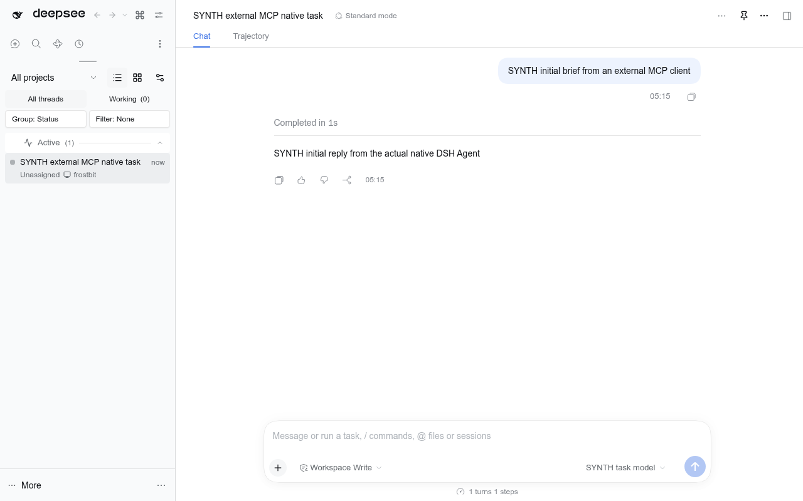

# DSH external MCP task gateway



A normal Node22.23.3 process exposing a **scoped task-management API** for one existing local DSH runtime. DSH owns the conversations, agent execution, tools, models and subagents. The gateway owns only authentication, grants and a durable admission/idempotency ledger. It does not run a second agent engine, import Codex chats, call private Dot endpoints, or require a backend browser.

The intended first client is genuine Yield, but nothing in the protocol depends on OpenAI. The gateway and dedicated private tunnel now run as enabled user services, and a real local native task has completed. Genuine Yield is **not connected yet**: workspace-access approval is pending. Follow the [current deployment and permission gate](docs/local-deployment.md), not the earlier source-only milestone. The screenshot above is explicitly the synthetic-provider scratch proof.

## Tools

| Tool | Authority and result |
| --- | --- |
| `dsh_health` | Authenticated readiness and allowed project aliases; no task creation. |
| `dsh_create_task` | Project alias, title, prompt and stable `idempotencyKey`; returns task identity/admission, not proof of successful work. |
| `dsh_send_message` | Queues one authorized follow-up on this principal's task, with an idempotency key. No arbitrary thread or steer permission. |
| `dsh_read_task` | Bounded latest visible text, sequence and observed native state; excludes hidden reasoning/tool arguments. |
| `dsh_list_tasks` | Paginated metadata for this principal's gateway tasks and current project grants only. It does not list every DSH conversation. |
| `dsh_cancel_task` | Requests cancellation of the native active turn and blocks further gateway follow-ups for that task. Cancellation acceptance is not termination confirmation. |

States include `accepted`, `running`, `completed`, `failed`, `cancellation-requested`, `cancelled`, `input-required` and `unknown`. V1 reports only states supported by observed native evidence. Completion means that the native turn ended, not that its claimed business result has been independently verified. Missing/stale inbox or turn evidence yields `unknown`, not a guessed terminal state.

**Cancellation limit:** native DSH cancellation retains its inbox and is not a universal kill/revoke for every descendant, job, goal or future schedule. Already queued native work can continue. The gateway does not claim otherwise; observe the task afterward and use the native controls for broader shutdown. Closing the gateway stops external admission, not already accepted DSH tasks.

## Local operator setup

Build from this repository with the pinned workspace toolchain:

```sh
# From apps/dsh-mcp-gateway after the reviewed workspace dependencies are installed:
node --run typecheck
node --run test
node --run build
node dist/main.js --help
```

Create an operator-owned configuration outside the checkout/image. The file must be a regular, non-symlinked, single-link file, not group/world writable. Values below are examples, not existing directories or credentials:

```json
{
  "listen": { "host": "127.0.0.1", "port": 8790 },
  "guiOrigin": "http://localhost:3198",
  "ledgerPath": "/srv/dsh-mcp/private/admission.sqlite",
  "upstreamLaunchUrlEnv": "DSH_MCP_LOCAL_DSH_URL",
  "projects": [
    { "id": "demo", "path": "/srv/projects/demo", "agentPreset": "minimal" }
  ],
  "principals": [
    {
      "id": "yield-private-tunnel",
      "tokenEnv": "DSH_MCP_YIELD_TOKEN",
      "projects": ["demo"],
      "actions": ["create", "send", "read", "list", "cancel"]
    }
  ]
}
```

Start with `actions: ["read"]` for a health-only proof before granting creation. Tool discovery hides ungranted actions. Project paths must already exist and resolve to themselves; project/preset choices are operator configuration, never caller-supplied filesystem paths or account/model selectors.

The ledger parent is created privately when missing and must be owned by this user with0700 permissions; its SQLite file must be0600, single-link, regular and non-symlinked. Existing unsafe permissions/ancestors are refused, not silently repaired. SQLite uses durable atomic claims across processes and is capped at100,000 retained operation records per principal. There is no automatic deletion of deduplication evidence; plan retention/reconciliation before reaching the cap.

Provision these **different** secrets in the operator/service environment through the existing secret manager, never in chat, tool arguments, a Git file or a process command line:

- `DSH_MCP_LOCAL_DSH_URL`: the current **loopback-only** tokenized DSH owner launch URL. It stays inside the gateway and is exchanged through the existing public DSH SDK. If `upstreamLaunchUrlEnv` is omitted, the SDK's normal private runtime launch-URL discovery applies. Do not send it to Yield or a remote MCP client.
- `DSH_MCP_YIELD_TOKEN`: a separately generated32–256-character base64url-style gateway key, not any OpenAI token. Each principal needs a distinct value.

Then run the app with only a non-secret config path:

```sh
node dist/main.js --config /absolute/operator-config.json
```

It listens only on loopback at `/mcp`. Each request must carry `Authorization: Bearer <gateway-key>`. No anonymous tool discovery, arbitrary DSH RPC relay, cookies, forwarded owner authority or browser Origin is accepted. Requests are bounded to128KiB, responses1MiB, concurrent requests16. SIGTERM/SIGINT stop admission and drain in-flight effects. A20-second failed shutdown exits nonzero rather than falsely reporting cleanup; durable uncertain intents are never silently replayed.

Configuration is loaded at startup. Change grants or environment-provisioned keys by restarting **the gateway**, not DSH; update the tunnel's matching local header reference as needed. A DSH owner-session/launch-URL change may also require refreshing the protected reference and reconnecting the gateway. Preserve the admission ledger across those restarts.

This is an adapter for **trusted orchestrators**. The upstream connection has DSH owner authority inside the gateway process. Project allowlists restrict task admission, not all filesystem/network actions of the resulting agent. Configure an appropriate native preset, tools, permissions, resource limits and approval policy. MCP metadata such as `destructiveHint` is not an authorization check or proof of human consent.

## Idempotency and uncertainty

Use a unique stable key for each logical mutation. Reuse that exact key and payload after a lost response. Keys are scoped to the authenticated principal across create/send/cancel, so reuse with different content or operation fails. Atomic ledger claims prevent duplicate dispatch even from another gateway process.

An intent is persisted before each native side effect. An acknowledged native Session is recorded even if later naming/prompting fails. A lost creation acknowledgment leaves only a possible identity: no transcript/state is read through it until ownership is confirmed. A crashed in-progress intent remains `busy`/`unknown`; it is never stolen after a timer. This favors no duplicate execution over automatic recovery. Operator reconciliation is required for uncertain cases—do not delete the ledger or change the key to hide uncertainty.

The native SDK also uses stable UUID prompt request IDs. The initial composition test exposed an invalid prefixed ID; a fail-first test through the actual SDK codec now covers that boundary.

## Reach the gateway from cloud Yield

Cloud Yield cannot access this machine by selecting `localhost`: that means the cloud runtime's own loopback. A URL shown to the user for a local DSH thread is not a cloud-accessible API.

### Recommended first deployment: private OpenAI MCP Tunnel

```text
Yield → OpenAI-hosted tunnel endpoint
               ↕ outbound authenticated HTTPS
       tunnel-client on the DSH machine
               → 127.0.0.1:8790/mcp
               → existing local DSH runtime
```

The MCP server and DSH remain private; no inbound firewall port or public domain is required. The machine and both services must stay online. You need a provisioned tunnel ID, a **Platform runtime key** with Tunnels Read+Use, and the account/workspace permission to connect it. Tunnel creation/changes need Manage. Do not run the daemon with an admin key and do not substitute a ChatGPT/Codex login.

The official tunnel client supports `mcp.extra_headers` with environment/file references. For this gateway, provision a private environment value `DSH_MCP_AUTHORIZATION` containing the full bearer header, and configure **both** normal and discovery/probe headers through references, not literal secret values:

```yaml
mcp:
  server_urls:
    - channel: main
      url: http://127.0.0.1:8790/mcp
  extra_headers:
    Authorization: env:DSH_MCP_AUTHORIZATION
  discovery_extra_headers:
    Authorization: env:DSH_MCP_AUTHORIZATION
```

Confirm this schema/flag shape with the exact installed `tunnel-client help samples`/`doctor --explain` before starting; current upstream documentation is not an installed-version proof. Connector-forwarded headers override static headers: an incompatible forwarded bearer must be diagnosed, not accepted by weakening gateway authentication.

A static local key represents the **authorized tunnel population**, not cryptographic proof of the individual Dot's identity. Use a dedicated restricted tunnel/principal and control its workspace grants; do not map an entire shared workspace to an unrestricted personal principal. First grant only health/read, have genuine Yield call `dsh_health`, compare the server-side proof, then deliberately grant task creation and test one brief/follow-up/cancel.

The authorized local deployment now uses a standalone production package, private0700/0600 operator files and a dedicated gateway user service. The official tunnel-client0.0.18 and two user-unit definitions are built/pinned through an isolated nixfiles topic, not an ad hoc global install or full Home Manager activation. A separate DSH tunnel was created; Discord's tunnel was not modified. The existing restricted Read+Use runtime credential was transferred privately through the authorized server account, never through model output. Its future rotation also affects this connection. Genuine cloud/Yield acceptance remains a separate gate until an actual call is observed.

References: [OpenAI Secure MCP Tunnel](https://developers.openai.com/api/docs/guides/secure-mcp-tunnels.md), [official onboarding](https://github.com/openai/tunnel-client/blob/master/docs/onboarding.md), [header/configuration reference](https://github.com/openai/tunnel-client/blob/master/docs/configuration.md), [ChatGPT custom-MCP connection](https://developers.openai.com/plugins/deploy/connect-chatgpt.md).

### Alternative: stable public HTTPS MCP endpoint

Use this for general cloud-client interoperability or public plugin distribution. Keep the gateway loopback-only behind a deliberately configured TLS/authentication proxy; forward only the gateway endpoint and rewrite its backend Host to the exact loopback listener. Do not publish DSH's raw owner API or use the GUI launch token as MCP authentication. Restrict Origin and proxy authority rather than trusting arbitrary forwarded headers.

V1 implements scoped bearer keys, **not an OAuth authorization server**. A client that requires OAuth needs an appropriate identity/authentication layer; do not disable authentication to make its connection UI succeed. Public plugin distribution has requirements beyond private tunnel testing. Hosting only this gateway elsewhere does not make local DSH magically reachable: it still needs an explicitly secured path to its runtime.

## Verification and limits

The [operator probe](scripts/verify-local.mjs) defaults to authenticated health only. Creation requires an explicit flag and authorizes one real native-model request asking for a fixed reply without tools, file changes, subtasks or schedules. It repeats the same creation key to verify no duplicate is admitted. A saved probe can be re-read without another model request:

```sh
node scripts/verify-local.mjs
node scripts/verify-local.mjs --confirm-create --project dshfiles
node scripts/verify-local.mjs --read-probe-task <existing-probe-task-id>
```

Use `--credential-file /absolute/private/gateway.env` for a different operator file; only a single-link, non-symlinked0600 file owned by this user is accepted. Do not use `--env-file`: Node22 pre-scans that reserved flag before script guards. A fail-first regression caught that collision. The live local probe already observed a real native completion, exact expected reply and identical identity for duplicate creation; this does not by itself prove the cloud path.

For this rootless systemd user deployment, filesystem namespace directives remapped root-owned ancestors to UID65534 and broke strict file ownership validation. The isolated Nix fix removes only those incompatible namespace directives and retains UMask0077, NoNewPrivileges and the other supported restrictions. These user units are **not filesystem sandboxes**; the application's private-file checks remain unchanged. An actual transient-unit test reproduces the old failure and proves ownership, SQLite writes and0600 creation with the fixed policy. No DSH or Discord restart is involved.

The server returns404 for absent OAuth metadata routes, while every actual `/mcp` request still requires its bearer credential. This permits the official tunnel client's plain-MCP discovery without inventing an OAuth server or opening anonymous tool access.

Focused checks cover durable real SQLite claims (including another OS process), grant isolation, key/payload conflicts, lost acknowledgments/restart, uncertain identity, conservative state mapping, HTTP authentication/Host/Origin/body/output/concurrency limits, redaction and shutdown draining. The public SDK's producer tests cover the requested Session ID and stable prompt UUID additions.

The real scratch journey exercises the ordinary compiled gateway CLI, official MCP SDK client, public DSH SDK, real native Session/Agent/logs and real GUI. Only the model-provider boundary is synthetic; no real provider account or funds are used. It verifies initial accepted→running→completed, duplicate create producing one native Session, follow-up in that Session, scoped list/read and wrong-key rejection, blocked native-turn cancellation accepted then observed aborted, and positive gateway/Host/private-root cleanup.

Run the feature with the official DSH executable/Node and isolated test state as recorded in [the progress plan](../../plans/durable-bots/external-mcp-gateway.md). No live DSH restart/profile mutation is part of verification. Source verification does not prove the customized live Host, production TLS/tunnel operation or genuine Yield connectivity. Those remain separate acceptance gates.
