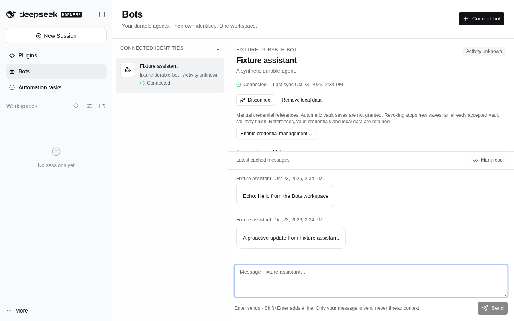
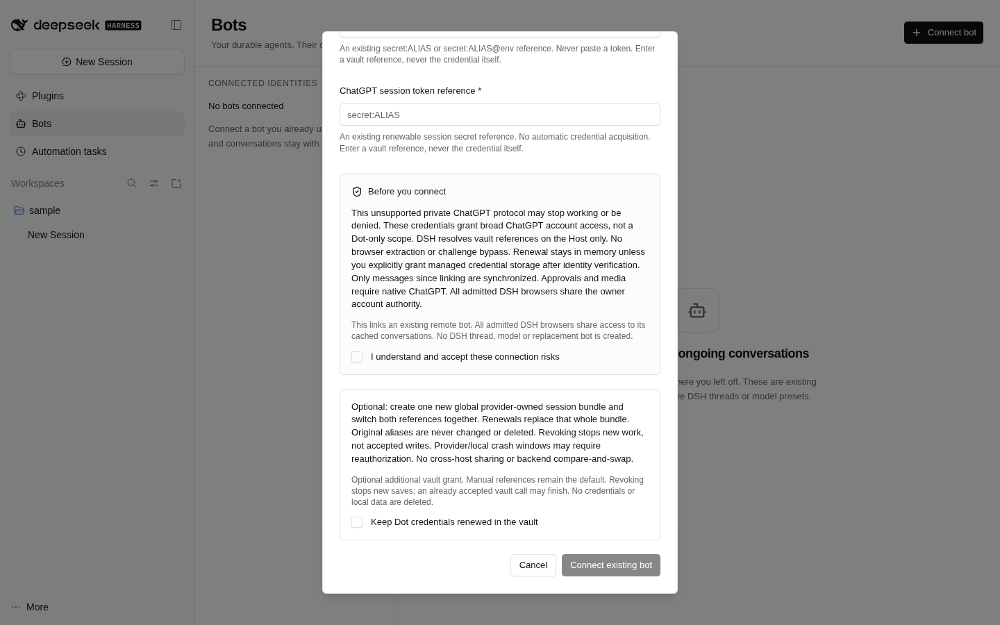
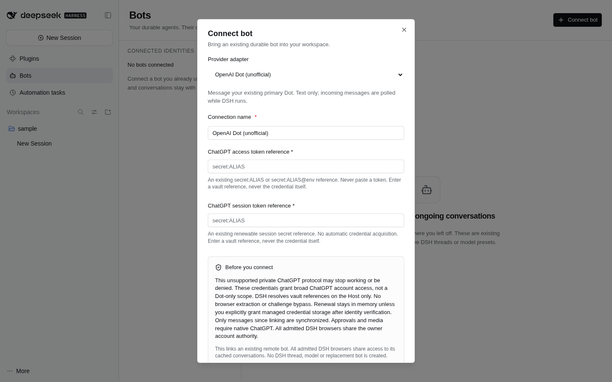

# Bots



_Synthetic provider fixture, not a real OpenAI account. Production supplies no sample bot identities._

A first-class workspace for **existing, long-lived remote bots**. Open **Bots** in the global sidebar; no project, native DSH Session, model preset or replacement bot is required.

**Build with dshx:** supported `sidebar.panellist` and `main` slots give remote identities their own home, without changing native Agents or thread semantics. The shared Host API owns connections, cached conversations and durable send requests; adapters own provider protocols. The generic client contains no provider-specific fields or account assumptions.

## Node HTTP service boundary

The `@dshfiles/bots/server` entry is an embeddable Node HTTP boundary over the same private `BotsEngine`, not a proxy to the running DSH and not another outbox. Its deployment supplies a `BotsStore`, an adapter registry and a separate service bearer token. Default binding is loopback on an ephemeral port; an operator may explicitly choose a container bind. It does not supply TLS: keep plain HTTP on loopback/private container transport, or terminate TLS at a trusted reverse proxy before wider exposure. The server owns and closes its engine, but the composition root owns persistence and registry registrations.

The API uses authenticated `GET /v1/snapshot` and JSON `POST /v1/<method>` routes matching the existing Bots contract, with a 64 KiB body cap and a 10-second incomplete-body deadline. `GET /healthz` contains no bot identity or transcript. All requests with an Origin header are rejected in this initial server-to-server boundary; it is not permissive browser CORS. The service token grants owner-level access and must stay in the trusted backend, never a browser URL or public frontend. The DSH Host client is implemented and synthetic real-HTTP verified; legitimate provider authentication still needs integration. Never copy the user's browser session or operate standalone and DSH workers over the same storage concurrently. If a request loses its response, delivery can remain unknown: retry only the same original UUID, never automatically invent another send.

The public `@dshfiles/bots/node` entry adds private JSON storage ownership and shutdown around this boundary. The [normal Node app](../../../apps/bots-service/README.md) has a CLI and a verified network-disabled container smoke; its runner reports no configured adapters by default. The DSH Host now supports explicit profile-owned `mode: "service"`, `serviceOrigin` and `serviceTokenReference` configuration. Omitted configuration preserves local mode; service fields without explicit service mode are refused. Service mode opens no local Bots store or workers, never falls back on failure, and disposing its HTTP client does not stop the Node owner. Origin must be root HTTPS or literal-loopback HTTP; redirects are forbidden. The service credential is resolved per request through the Host's canonical reference resolver, or `DSH_BOTS_SERVICE_TOKEN` only when the reference is empty. This is deployment configuration, not a live settings switch or data migration; activation is still separate. The native storageDomain service remains an activation dependency for compatibility, but no Bots domain is opened in service mode.

The private DSH account-authority channel and normal Node composition are implemented. External account mode uses a nonsecret selected-account ID and a separately authenticated backend capability; it never copies vault aliases, cookies or refresh storage into the worker. A real scratch GUI now verifies remote account-mode metadata, explicit risks and sanitized denial, with no local Host Bots domain, private browser bytes or provider requests. Real account acceptance and live activation remain unverified; the real Yield UI exchange is separate, not a backend test.


_Synthetic remote-service denial fixture only. These captures prove the account-mode form and safe failure path, not successful OpenAI authentication._

## Use

1. Install and enable a compatible bot adapter. Without one, the roster is honestly empty and **Connect bot** explains that adapters are unavailable.
2. Choose **Connect bot**, select a provider adapter and name the connection.
3. Fill the fields the adapter declares. Credential fields accept only `secret:ALIAS` or `secret:ALIAS@ENV`, with the shared vault-reference binding. **Never paste a raw token.** The Host resolves references; the browser never receives a credential value.
4. Read the adapter's risk disclosure and explicitly accept it. Connecting links the remote identity the adapter discovers, not a new bot. If supported, a **separate, initially unchecked** optional checkbox grants managed credential-reference updates; leave it unchecked to keep manual references.
5. Select a bot and its provider conversation. Send with **Send** or Enter; Shift+Enter adds a line. Only the typed message is sent—no private DSH thread context is attached.

The roster shows identity, provider, unread count and connection health. Remote activity is separate: **Activity unknown** does not mean idle, stopped or unhealthy. The detail pane shows last sync, local history scope and a validated original-app handoff when the adapter supplies one.

The latest conversation opens at the bottom and follows incoming messages while you stay near the bottom. Scrolling up preserves your reading position; when updates arrive below you, **Jump to latest** returns to the current message. Explicitly selected older pages do not auto-jump.

At narrow container widths the roster and detail are separate views. **Back to bots** returns to the roster. Drafts are keyed by bot and conversation and survive pane navigation or a temporary disconnect in this browser's memory. They do **not** survive a full page reload. Transcripts, secrets and prompts are never written to browser storage.

## Delivery and local controls

- Every new send has one UUID. An explicit **Retry original send** uses that same UUID and body. Failed transport can mean **Delivery unconfirmed**: the message may already have arrived. Reconnect never silently sends a draft or creates a fresh retry.
- **Mark read** updates the local unread boundary, not a remote read receipt.
- **Disconnect** stops local synchronization and retains cached history. It does **not** stop or delete the remote bot; remote work may continue while DSH is closed.
- **Remove local data** requires a confirmation naming the connection. It removes the local connection, cache and in-memory drafts, not the remote identity or vault credentials.
- Disconnected, unavailable and non-text-capable conversations are read-only. Drafts remain editable; send is disabled until the connection and conversation are available.
- Messages render as React text, never raw HTML. Unsupported attachments/approvals are notices, not actions. Native handoff links must be credential-free HTTPS URLs supplied by the adapter; invalid links are not rendered.

The provider conversation remains canonical. A **Local cache since linking** disclosure means exactly that—not a full historical import. The client pages a bounded cache and makes no claim to provider features that its adapter cannot support.

## Optional managed credential references



_Real scratch GUI with adapter metadata only; no account connection or vault write._

Manual reference mode remains the default, including connections saved before this capability existed. An adapter may advertise `info.credentialManagement: { label, description }`. Its connect checkbox is an **additional vault-management grant**, independent of connection-risk consent; connection risk acceptance alone never enables management.

In a bot's detail pane (or an unverified connection's card), **Enable credential management…** opens a consent dialog with an initially unchecked grant. **Revoke credential management** does not require another confirmation. The shared `setCredentialManagement({ connectionId, enabled, acceptRisks? })` API and `bots_set_credential_management` tool expose the same action: enabling requires advertised support and explicit `acceptRisks: true`; both tools and UI require the user's additional vault grant. Revocation remains available if the adapter is missing. An enabled connection restarts its worker to invalidate old callbacks; a disconnected connection stays disconnected. References, credentials, cached history and drafts are retained.

Revocation stops **new** saves; a vault call already accepted by another owner may finish. It is not a provider/vault transaction or a promise of rollback. Bots neither reads nor writes raw credential values: provider adapters own those operations through their separately granted capabilities.

After verifying and durably persisting the same account, bot and conversation continuity, Core may call the session's optional `bindCredentialReferences({ connectionId, publish, signal })`. `open` receives the optional `connectionId` (Core always supplies it); neither API exposes a publisher in manual mode. The binding signal lasts for the worker's lease, including after binding completes. Core stays **Connecting** until binding and its started reference publications are durable, then schedules synchronization.

The built public `@dshfiles/bots/adapter` module owns these exact neutral types:

```ts
interface BotCredentialReferenceUpdate {
  readonly previous: Readonly<Record<string, string>>
  readonly next: Readonly<Record<string, string>>
}
interface BotCredentialReferencePublisher {
  assertActive(): void
  replace(update: BotCredentialReferenceUpdate): Promise<void>
}
```

Both maps are the **full configuration**, not partial reference patches. `assertActive` guards the current worker/session, account and grant before an adapter starts new vault work. `replace` rechecks that lease inside the serialized store mutation, validates both maps and atomically compares/replaces the expected full map. Only canonical references in declared secret-reference fields may change; non-secret values and keysets cannot change. Both references commit in one Core row. An already-committed identical retry succeeds; a different stale expected map fails. A successful durable commit is not subsequently reported as cancelled, so adapters must not discard ownership of its committed aliases. No cross-provider or Core/vault transaction is implied.

## Ownership and availability

The Host owns synchronization even while this workspace is closed. The client uses Query snapshots and cached-message queries with abort signals and bounded refetch intervals, not React polling loops. A missing Bots API owner shows **unavailable** and stops polling rather than crashing the slot. Each decorated slot root supplies its own Query provider.

All admitted browsers share DSH's owner authority and the same Host cache. This is not per-human account isolation and is not an endorsement for shared-user deployment. Adapter configuration metadata and safe connection state are available through the same `botsApi` methods used by agent tools; private message text is read only through the explicit conversation API.

## Adapter extension contract (v1)

Import `BotAdapter` and `BotAdapterError` from the built public `@dshfiles/bots/adapter` module. Register through the Host's injected `botAdapters` registry, returning registration disposal from the owning `ctx.effect`. See the [Dot Host consumer](../bot-openai-dot/src/host.ts) and the independent [minimal adapter substitution tests](src/engine.test.ts). No provider discriminator branches or UI imports belong in Bots core.

- `info` declares provider name, risk disclosure and field metadata; configuration holds canonical secret references, never credential values. `validateConfig` rejects unsupported input before persistence.
- `open` verifies the authenticated account and existing remote identities. Its session declares provider conversation IDs and history boundaries; reconnect must not repurpose them. Names and supported text capability may refresh without replacing identity.
- `poll` is cancellable and returns at most 100 normalized messages with an opaque cursor (at most 2,000 characters) and `hasMore`. The Host schedules polling from the declared one-second to five-minute cadence; the adapter does not start another polling owner.
- `send` uses the supplied request UUID as the provider idempotency key and returns the verified **user** message. `reconcile` returns `found`, `not-found` only after a complete absence check, or `unknown` when proof is incomplete. It uses the persisted original `initialCursor`, not reconnect discovery's fresh boundary.
- A message's remote ID and author own its editable projection. User request IDs identify idempotent operations; a bot reply can correlate to one but must keep its own remote message ID. User request-ID reuse with a changed body/new remote ID fails safely rather than losing content silently.
- `close` releases provider resources. Every network operation must honor its `AbortSignal`; late results after disconnect/removal are not committed.
- Only deliberately safe `BotAdapterError` messages may reach users. Do not include credentials, upstream bodies or raw causes. Unexpected failures get a static safe explanation.
- V1 supports text and read-only conversations. Attachments, inline approvals and activity-reporting flags are reserved and rejected until matching neutral operations and UI exist; do not advertise unsupported capabilities.

## Storage limits and privacy

The local projection retains the latest **500 settled messages per conversation**, bounded to **10,000 globally**, plus at most **1,000 unresolved outgoing intents**. Pruning never silently drops pending work. Up to **10,000 non-expiring outgoing request tombstones** prevent changed or duplicate sends even after projection pruning. Once full, only **new sends** are refused; reconciliation and incoming synchronization continue. Explicit removal clears that connection's local ledger. Incoming replay remembers a rolling **20,000 remote IDs/user operation fingerprints**; beyond that horizon, the adapter cursor and canonical provider remain the authority.

One storageDomain atomic row commits projection, ledger and cursor together. This cache contains private message text in standard DSH storage; it is not separately encrypted. Protect DSH's home and its backups. No credential values are stored in this row.

## Connection form



This capture has no credentials and does not authenticate an account. Both bundles are included in the checked-in web profile seed after isolated verification; applying that seed to a running installation and restarting remain separate user decisions. See the [architecture and deployment guide](../../../docs/bots.md).

## Verification map

- [UI helper tests](src/bots-ui-model.test.ts): metadata-driven forms, explicit risk consent, canonical reference validation, provider substitution, bot/conversation draft isolation, original retry UUID/body, stale completion rejection, safe handoff URLs and chronological projection.
- [Connection dialog DOM tests](src/bots-connect-dialog.test.tsx): valid fields followed by explicit consent enable immediate submission without an extra blur; revoking consent disables submission again.
- [Conversation viewport DOM tests](src/bots-conversation-viewport.test.tsx): initial/near-bottom following, preserved older reading, explicit jump, pane/composer resizing and older-page behavior.
- [Credential lifecycle tests](src/credential-lifecycle.test.ts): manual-mode migration/defaults, explicit grants, post-continuity binding, durable two-reference CAS, canonical-map rejection, idempotent retries, stale/cancelled/revoked callbacks, storage failure and accepted-commit acknowledgment.
- [Credential permission DOM tests](src/bots-credential-management.test.tsx): fresh unchecked enable consent, cancellation/reset, explicit grant API dispatch and revoke without deletion or another consent prompt.
- [Query policy tests](src/bots-queries.test.ts): abort-signal forwarding, cache-key isolation, bounded refetch intervals and missing-owner polling/retry shutdown.
- [Browser journeys](../../../tooling/dshx/e2e/features/bots.feature): empty/no-adapter workspace; two-reference adapter metadata without real account linking; scratch-only synthetic adapter exercising connect, send/echo, unsolicited incoming messages, draft navigation, 360/480 px container Back navigation, disconnect/reconnect without resend, and explicit local removal.
- [Feature catalog](dshx.features.json): `bots-workspace` and `connect-bot`, with exact journey IDs, states, failure boundaries and supported scratch reaches.
- Screenshot target: [Bots workspace](docs/screenshots/bots-workspace.png), captured from a scratch instance, never the live user's account.

```sh
pnpm --dir plugins/@dshfiles/bots typecheck
pnpm --dir plugins/@dshfiles/bots test
pnpm --dir plugins/@dshfiles/ui-styles build
pnpm --dir plugins/@dshfiles/bots build
pnpm check:e2e bots
```

Synthetic-provider proof does not prove a real external account can link. Provider authentication, private-protocol compatibility and account-specific access remain separately authorized, real-account verification gates. No live DSH instance needs to be changed to exercise the isolated UI journeys.
