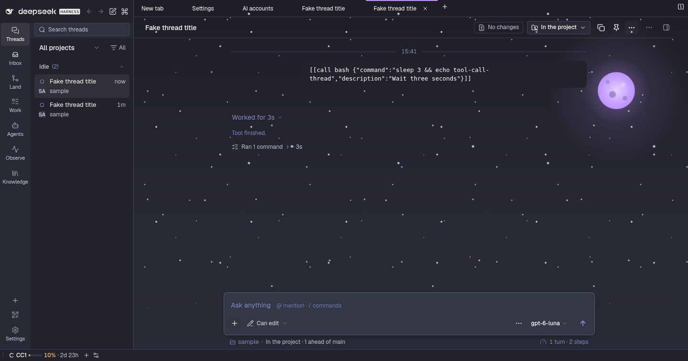

# @dshfiles/ui-styles




The one bundle that compiles and injects the shared `@dshfiles/plugin-ui` stylesheet (the ordered union of every owned
plugin's classes), and the owner of the theme.

## Theme

- **First paint.** `src/theme.generated.css` is the static visual-refresh theme (warm stone, indigo accent, status
  trios, radii, Shiki colours) generated from `plugin-ui/src/theme/palette.ts`; `src/fonts.css` sets Geist and Geist
  Mono through the Host's default font stacks. It retunes the Host `--dsw-*` variables, so native core surfaces and
  plugins share one palette. Regenerate with `node plugins/@dshfiles/plugin-ui/scripts/emit-theme-css.ts`.
- **Appearance settings** (namespace `dshfiles-ui-styles`, Settings › General › Appearance): a preset (Warm stone,
  Neutral, High contrast, Slate blue, Moss, Dracula), optional grey hue, grey tint, accent hue and contrast overrides, and the
  interface and code font, and an optional serif for reply prose (**Reading font**, off by default: a system serif —
  Charter, Iowan Old Style or Georgia — so nothing is downloaded; code and tables keep their fonts). Light, dark or
  system stays the native `ui-theme` setting.
- **Runtime.** The client regenerates the palette with the same generator (`plugin-ui/theme/appearance`) and injects
  one `<style id="dshfiles-ui-styles-theme">` whose selectors out-rank the static block, only when the settings differ
  from the default; the default injects nothing. The last custom CSS is cached in localStorage and applied before the
  settings mirror answers, so a reload of a custom theme does not flash warm stone.
- **Saved themes (any theme on request).** A theme is data (`plugin-ui/src/theme/theme-definition.ts`): per scheme,
  exact `#rrggbb` colours for the eleven neutral steps (`bg` … `text`), the accent and status colours, optional Shiki
  syntax colours, and an optional backdrop of 1–3 full-size layers behind the main workbench (the conversation and its
  tabs; sidebars, dialogs, bubbles and the composer stay opaque). Ask the agent for any theme; it calls `theme_define`,
  the definition lands in the hidden `customThemes` setting and `customTheme` switches to it, live, with no restart.
  The generator still retunes every Host ramp from the theme's own background and accent hue, then the definition's
  colours are pinned over it; a scheme the theme leaves out keeps the generated palette. A backdrop is gradients and
  animations only: `url()`, `@import` and braces in a layer are refused, so a theme never loads anything, and
  `prefers-reduced-motion` stops its animations. Any grey, accent or contrast override drops the pins and the backdrop
  in favour of the generated palette.
- **Dracula.** A built-in saved theme from the [official spec](https://draculatheme.com/spec): Dracula Classic in dark,
  with a night sky (a fixed star field, two star layers twinkling out of phase, a violet moon top right; only `opacity`
  animates, so nothing repaints per frame), and Alucard Classic, Dracula's official light companion, in light. Every
  colour is the spec's except roles it has no colour for (faint and secondary text, strong border) and red text on
  dark, which uses a brighter red to stay readable.
- **Contrast.** Every preset, and every corner of the override bounds, keeps WCAG AA for text in light and dark
  (`plugin-ui/tests/appearance.test.ts`); the generator darkens (light) or lightens (dark) an accent hue that would
  fall below AA. A saved theme keeps its exact colours: text under AA is reported in `contrastWarnings` instead of
  being altered (Alucard's red and yellow sit at 4.1–4.3:1 on its secondary fills).
- **Agent tools.** Bound to the `ui-theme-appearance` API in `src/api.ts`, the same settings the form writes:
  `theme_get` (read-only), `theme_set` (preset, `customTheme`, overrides, fonts; `reset: true` restores the defaults
  and keeps saved themes), `theme_define` (save a theme and switch to it) and `theme_remove` (`confirm: true`). Writes
  run only when the user asked.

Interface font choices are Geist and the system font; Inter is not vendored (loading it only when chosen needs a Host
static-asset route).

## Verify

```sh
pnpm --dir plugins/@dshfiles/ui-styles test   # theme drift, Host variable guard, settings and tool transitions
pnpm check:e2e ui-styles                      # isolated-boot sheet, preset + reload + reset, agent tool round trips (theme_set, theme_define/remove)
```
