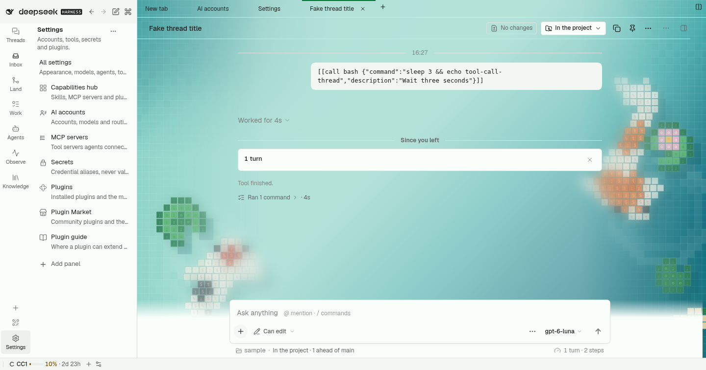
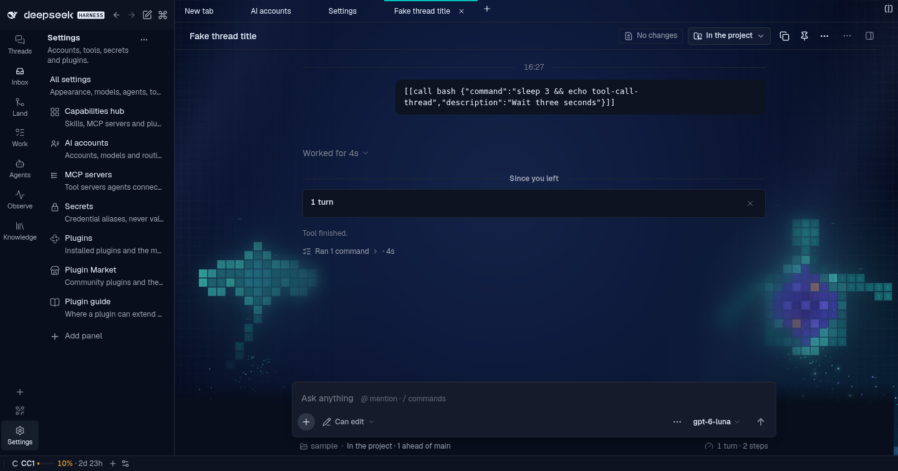
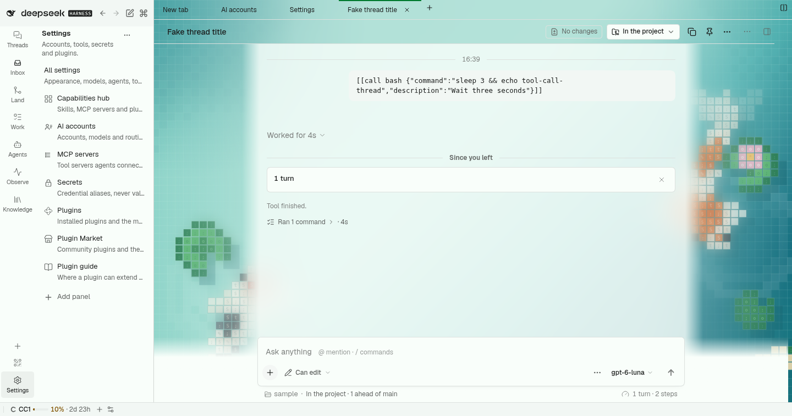

# @dshfiles/ui-styles








The one bundle that compiles and injects the shared `@dshfiles/plugin-ui` stylesheet (the ordered union of every owned
plugin's classes), and the owner of the theme.

## Theme

- **First paint.** `src/theme.generated.css` is the static visual-refresh theme (warm stone, indigo accent, status
  trios, radii, Shiki colours) generated from `plugin-ui/src/theme/palette.ts`; `src/fonts.css` sets Geist and Geist
  Mono through the Host's default font stacks. It retunes the Host `--dsw-*` variables, so native core surfaces and
  plugins share one palette. Regenerate with `node plugins/@dshfiles/plugin-ui/scripts/emit-theme-css.ts`.
- **Appearance settings** (namespace `dshfiles-ui-styles`, Settings › General › Appearance): a preset (Warm stone,
  Neutral, High contrast, Slate blue, Moss, Dracula), optional grey hue, grey tint, accent hue and contrast overrides, and the
  interface and code font, and an optional serif for reply prose (**Reading font**, off by default: a system serif —
  Charter, Iowan Old Style or Georgia — so nothing is downloaded; code and tables keep their fonts). Light, dark or
  system stays the native `ui-theme` setting.
- **Runtime.** The client regenerates the palette with the same generator (`plugin-ui/theme/appearance`) and injects
  one `<style id="dshfiles-ui-styles-theme">` whose selectors out-rank the static block, only when the settings differ
  from the default; the default injects nothing. The last custom CSS is cached in localStorage and applied before the
  settings mirror answers, so a reload of a custom theme does not flash warm stone.
- **Saved themes (any theme on request).** A theme is data (`plugin-ui/src/theme/theme-definition.ts`): per scheme,
  exact `#rrggbb` colours for the eleven neutral steps (`bg` … `text`), the accent and status colours, optional Shiki
  syntax colours, and an optional backdrop of 1–3 full-size layers behind the main workbench (the conversation and its
  tabs; sidebars, dialogs, bubbles and the composer stay opaque). Ask the agent for any theme; it calls `theme_define`,
  the definition lands in the hidden `customThemes` setting and `customTheme` switches to it, live, with no restart.
  The generator still retunes every Host ramp from the theme's own background and accent hue, then the definition's
  colours are pinned over it; a scheme the theme leaves out keeps the generated palette. A backdrop is gradients and
  animations only: `url()`, `@import` and braces in a layer are refused, so a theme never loads anything, and
  `prefers-reduced-motion` stops its animations. Any grey, accent or contrast override drops the pins and the backdrop
  in favour of the generated palette.
- **Gallery themes.** Sixteen built-in themes paint the twenty animated scenes of Claude Code's `theme-examples`
  plugin (Honu Lagoon, Koi Mosaic, Night Reef, Snow Pines, Aurora, Blueprint…; the four drawn for both kinds of window
  are paired into one light-and-dark theme). The scene code is vendored unchanged under `src/vendor/theme-examples`
  (Apache-2.0, provenance and update policy in its `NOTICE.md`) and runs on the Host only: the client asks the `scene`
  method of the theme API for the SVG it needs and paints it as a data URL, so the browser bundle never carries the
  builders and nothing is fetched from the network. A scene sits under its own glass tint, strongest under the
  conversation column. Each scene only shows in the scheme it is drawn for; the colours are the generated
  palette retuned to the scene (WCAG AA). An SVG painted as an image cannot see `prefers-reduced-motion`, so the page
  swaps in the scene's own resting picture under that query. `theme_set { customTheme: "night-reef" }` picks one;
  `theme_get` lists them in `galleryThemes`. A saved theme can paint a scene too (`backdrop.scene`).
- **Reading veil and readability.** Under the conversation column, a theme with a backdrop lays a veil of its own
  background colour. Its opacity is the smallest that keeps the theme's text readable anywhere over that scene
  (`plugin-ui/src/theme/readability.ts`: primary text 4.5:1, and secondary and tertiary greys such as "5 other tool
  calls", "Worked for 14s" and the copy and more-actions glyphs at least as readable as on the theme's plain
  background, over 95% of a coarse sample of the scene's whole resting picture under its glass, taken once by the
  client; a column can sit anywhere, in a split or beside a wide sidebar), so text never lands on a part of the scene
  it cannot be read on; 0 when the scene is calm enough. A textured scene reads as less contrast than a flat
  background, so inside conversations over its scene a theme also lifts its own greys a little (tertiary halfway to
  secondary, secondary 30% toward primary, `GREY_LIFT` in `theme-definition.ts`) and its veil is computed for those
  colours. Plain themes, Dracula's night sky and every other surface keep their greys. Two settings add to it: `readingBlur` (0–24 px) and `readingTint` (0–100 %), in
  Settings › Appearance or `theme_set { readingBlur, readingTint }`. Where the browser composites on a GPU (the client
  probes WebGL once and sets `data-dshx-gpu` on `<body>`; a software rasteriser such as SwiftShader or llvmpipe counts
  as none), the blur is a live `backdrop-filter` over the moving scene. Without one it is a pre-blurred still of the
  scene, rasterised once and fixed to the viewport like the scene, so nothing is filtered per frame (a live filter there
  re-blurred the moving scene on the CPU every frame: 8 fps). The scene's glass is a gradient tint for the same reason.
  Both settings are kept across theme changes; `reset: true` sets them to 0.
- **One backdrop, no seams.** The scene is one picture fixed to the viewport behind the whole main workbench: docked
  panes drop the transform and paint containment of Dockview's render overlays (which made each pane re-fit the
  scene's still to itself), so split conversations share one continuous scene. Only conversation panes show it; every
  other pane (Settings, Backlog, a view chooser) keeps the theme's own background. The composer seat continues the veil
  (the same tint over the same still) instead of a band of plain background, and chrome outside the column reads on
  surfaces the theme hands it: the turn rail on `--dshx-backdrop-chrome` (the theme background at the opacity its
  tertiary text and strong borders need over the whole scene), the user's bubble with a hairline ring
  (`--dshx-backdrop-bubble-ring`, the strong border step) so it stands apart from the scene behind it.
  `plugin-ui/tests/backdrop-readability.test.ts` holds every gallery theme in both schemes, and a saved theme whose
  palette fights its scene, to all of this over Chrome's own raster of each scene
  (`plugin-ui/tests/fixtures/scene-samples.json`; `node plugins/@dshfiles/ui-styles/scripts/sample-scenes.mjs`
  regenerates it after a scene changes).
- **Dracula.** A built-in saved theme from the [official spec](https://draculatheme.com/spec): Dracula Classic in dark,
  with a night sky (a fixed star field, two star layers twinkling out of phase, a violet moon top right; only `opacity`
  animates, so nothing repaints per frame), and Alucard Classic, Dracula's official light companion, in light. Every
  colour is the spec's except roles it has no colour for (faint and secondary text, strong border) and red text on
  dark, which uses a brighter red to stay readable.
- **Contrast.** Every preset, and every corner of the override bounds, keeps WCAG AA for text in light and dark
  (`plugin-ui/tests/appearance.test.ts`); the generator darkens (light) or lightens (dark) an accent hue that would
  fall below AA. A saved theme keeps its exact colours: text under AA is reported in `contrastWarnings` instead of
  being altered (Alucard's red and yellow sit at 4.1–4.3:1 on its secondary fills).
- **Agent tools.** Bound to the `ui-theme-appearance` API in `src/api.ts`, the same settings the form writes:
  `theme_get` (read-only), `theme_set` (preset, `customTheme`, overrides, fonts; `reset: true` restores the defaults
  and keeps saved themes), `theme_define` (save a theme and switch to it) and `theme_remove` (`confirm: true`). Writes
  run only when the user asked.

Interface font choices are Geist and the system font; Inter is not vendored (loading it only when chosen needs a Host
static-asset route).

## Verify

```sh
pnpm --dir plugins/@dshfiles/ui-styles test   # theme drift, Host variable guard, settings and tool transitions
pnpm check:e2e ui-styles                      # isolated-boot sheet, preset + reload + reset, agent tool round trips (theme_set, theme_define/remove)
```
